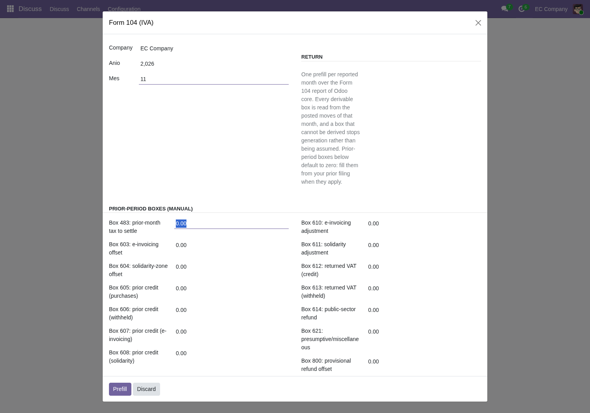

Prefilling a month:

`l10n.ec.104.generate` takes a company, a year and a month, and pre-fills
every derivable box of that month's Form 104 from its posted moves:
the sales block (401-454), the purchase block (500-560) and the settlement
(480-499, 563-565, 601-699, 799-859).

In the interface it is **Invoicing ‣ SRI ‣ Form 104 (IVA)**, a dialog asking
for the company, the year and the month with a single **Prefill** button.
The button offers a CSV download (`formulario_104_YYYYMM.csv`) and renders
the same boxes on screen. The filing itself happens in the SRI portal:
carry the CSV values over, review the suggested boxes (563/564/565 and any
carryover you filled), and complete the manual boxes there.

Prior-period boxes (prior 485, prior credit balances, compensations and
adjustments) are not derived: fill the matching `carryover_*` fields from
your prior filing before pressing Prefill. They default to zero and are
reported as carried, never as computed.

Everything that cannot be derived arrives in **one** `UserError`, numbered,
and no file is produced. A company filing outside Ecuador is refused the
same way. Nothing is computed and nothing is assumed on refusal.

Evidence (November 2026 seed, company 4):

Verified on the November 2026 demo seed, company 4. Document counts (D8):
111=1, 113=0, 115=5, 117=0, 119=0. Sales: 401=800, 411=800, 421=120,
429=120. Purchases: 500=2350, 510=2250, 520=337.5. Settlement: 602=217.5,
609=36.0 (retained VALUE, 30% of 120, D9), 727=75.0 (retained VALUE, 50%
of 150, D9), 799=75.0, 801=75.0, 620=-253.5, 699=-253.5, 859=-178.5.
Limits: 113/117/119 read 0.0 (no seed docs; ATS seed frozen since PR #105
closed); exterior boxes read 0.0 (see ROADMAP).
