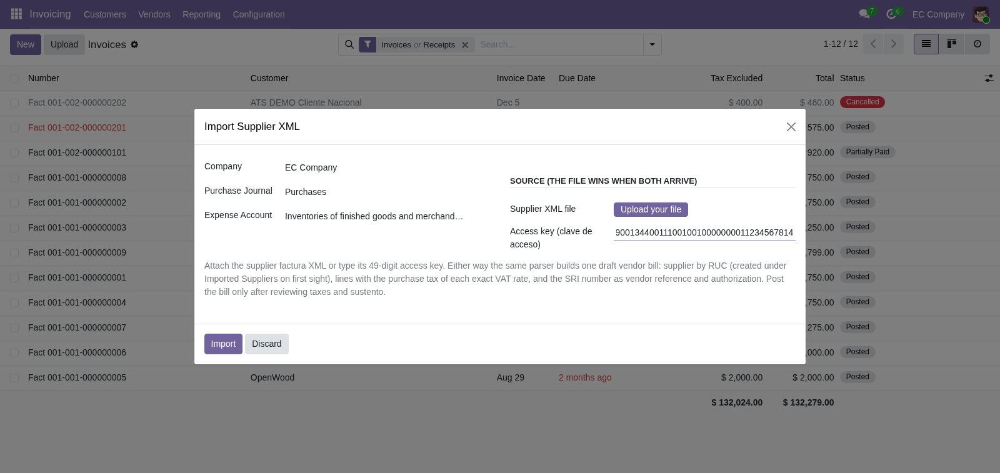

Importing a month of supplier XMLs:

1. Open **Invoicing ‣ SRI ‣ Import SRI XML**.
2. Either attach the supplier `factura` XML, or type its 49-digit access
   key (`clave de acceso`). When both arrive, the file wins.
3. Press **Import**. The wizard creates one draft vendor bill and opens
   it: supplier resolved by RUC (auto-created under Imported Suppliers
   on first sight), SRI number as vendor reference, authorization key on
   the Ecuadorian authorization field, one bill line per XML detail
   with the purchase tax of its exact VAT rate, and the source XML
   attached to the bill.
4. Review taxes, sustento and amounts, then post the bill. An already
   imported invoice (same supplier + SRI number, or same authorization
   key) is refused instead of duplicated.

## Customer withholding (07) door

When the customer withholds on OUR sale (renta + IVA) and sends their
`comprobanteRetencion` (07, where they are the agent):

1. Open **Invoicing ‣ SRI ‣ Import SRI XML**.
2. Either attach the customer retencion XML, or type its 49-digit access
   key. When both arrive, the file wins.
3. Press **Import**. Every referenced sustento is matched to one of OUR
   posted sale invoices by SRI number with the 07 emisor RUC as customer;
   then the manual sale-withhold wizard posts the sale voucher with its
   usual lines, invoice links and reconcile attempt, and the source XML
   is attached to the voucher.
4. Anything unmatched (unknown number, another customer, draft invoice),
   duplicated (same customer + retencion number, or same authorization
   key) or unresolvable (unknown withholding rate) is refused with a
   manual-allocation message: never a silent creation, never a guess.

By access key:

1. Type the 49 digits and press **Import** with no file attached.
2. The wizard queries the public SRI `autorizacionComprobante` service
   (no certificate), unwraps the authorized `<comprobante>` and runs
   the same parser. When the SRI stays silent (recent authorizations
   only, no SLA), upload the file instead.
